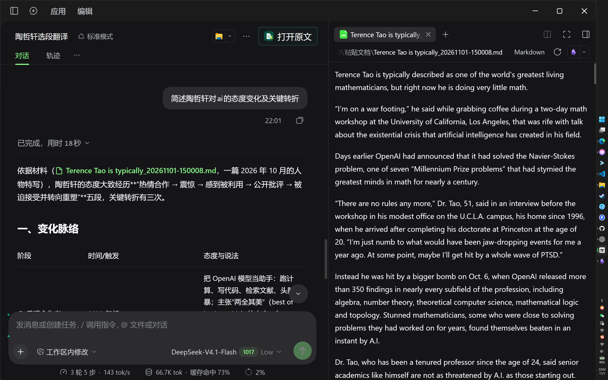
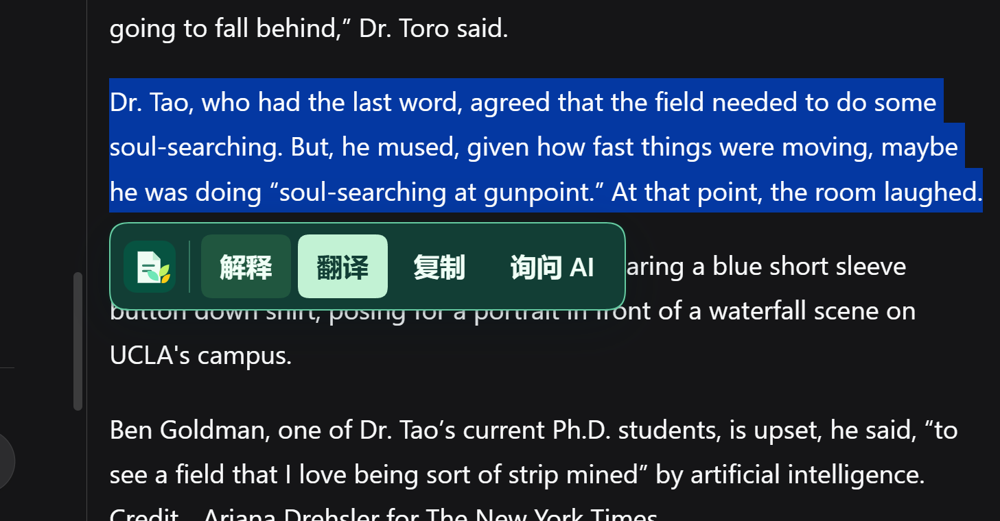
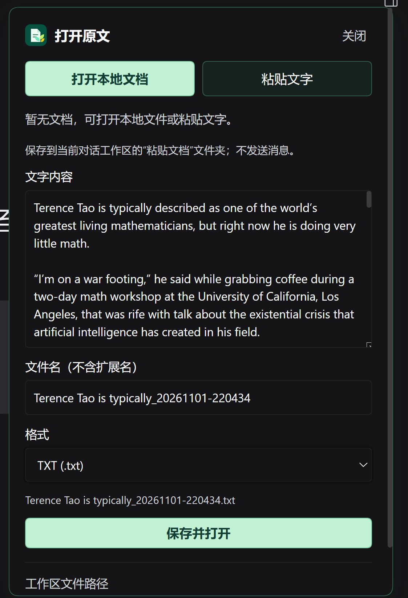
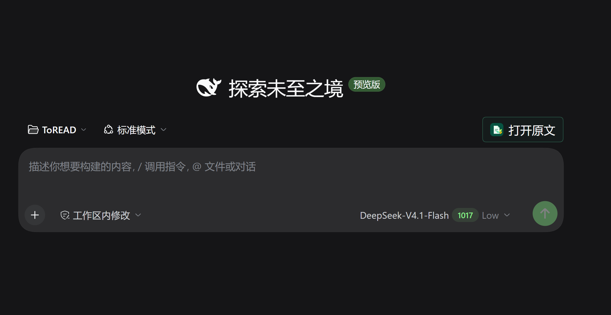

# QiaoDoc for DeepSeek Harness

[简体中文](README.md) | **English**

Open a document beside your current DeepSeek Harness conversation to read, translate, and ask questions.

Inspired by Doubao's web split-view reading experience, QiaoDoc keeps the native Harness conversation. Preview PDF, TXT, Markdown, and HTML files, or save pasted text as TXT or Markdown and open it for reading.

Select a passage and click **Explain** or **Translate** to send the passage and its source to the current conversation. **Ask AI** adds a quotation to your draft so you can edit it before sending. Responses use the model selected in the current conversation.

## Feature preview

These desktop screenshots demonstrate the interaction with example content. Click an image to view the original. The screenshots show the Chinese interface.

### Conversation and original document side by side

Continue the conversation on the left while reading the original document independently on the right.



### Explain, translate, or ask about a passage

Select text to explain, translate, copy, or ask AI about it without switching conversations.

<p align="center">
  <a href="docs/qa/qiaodoc-selection-v1.png"></a>
</p>

### Paste text, save it, and start reading

TXT is the default format; Markdown is also available, and the filename is editable. Files are saved in the `粘贴文档` folder within the current conversation's workspace. Saving a file does not send a message.

<p align="center">
  <a href="docs/qa/qiaodoc-paste-text-v1.png"></a>
</p>

<details>
<summary>Open a document from a new conversation</summary>

In a new conversation, click **Open document** (打开原文 in the screenshots) to choose a local document or paste text.

<p align="center">
  <a href="docs/qa/qiaodoc-new-chat-entry-v1.png"></a>
</p>

</details>

Previously opened files appear in **Document history**, grouped by format. You can return to the original conversation and reading position.

## Installation and compatibility

This is a development preview, verified only on **Windows with DeepSeek Harness 0.2.1-rc.5**. The installation package name is `qiaodoc-dsh`.

1. Download the `.tgz` installation package and `SHA256SUMS` for your chosen version from **Assets** on [GitHub Releases](https://github.com/4444Hao/qiaodoc-dsh/releases). Packages become available when a release is published; this method requires a release with a `.tgz` attachment.
2. Save your drafts and fully quit DSH, including its tray process. Replace the two paths below with your actual locations, then install in PowerShell:

```powershell
$dshCli = 'D:\dsh-desktop\resources\runtime\cli\bin\dsh.cmd'
$packageFile = 'C:\Downloads\qiaodoc-dsh-1.2.0-dev.7.tgz'
& $dshCli plugin --profile desktop add $packageFile
```

3. Reopen DSH and click **Open document** in your conversation. To update, install the newer `.tgz` and reopen DSH.

For detailed installation and rollback instructions, see the [installation guide](docs/INSTALLATION.md) (currently in Chinese).

## Known limitations

- HTML preview is supported, but the selection AI menu is not yet available inside rendered HTML pages.
- Native sidebar reading for EPUB, OCR for scanned documents, and full-document bilingual layouts are not provided.
- Unsaved pasted text may not survive a refresh, conversation switch, or host restart. Save it promptly.

For verification scope and remaining limitations, see the [acceptance report](docs/ACCEPTANCE-REPORT.md). Development and testing records are listed in the [maintenance documentation](docs/README.md). These supporting documents are currently in Chinese.

## Origin and license

This project is derived from [Qiaomu Reader DSH](https://github.com/joeseesun/qiaomu-reader-dsh), developed and maintained by joeseesun. The main changes are reading within native conversations, passage actions, document history, and saving pasted text. It is independently maintained at [4444Hao/qiaodoc-dsh](https://github.com/4444Hao/qiaodoc-dsh) and is not an official successor to the upstream project.

The project continues to use **GPL-3.0-only** and retains applicable upstream copyright and license notices. See [LICENSE](LICENSE) and [third-party notices](THIRD_PARTY_NOTICES.md).
