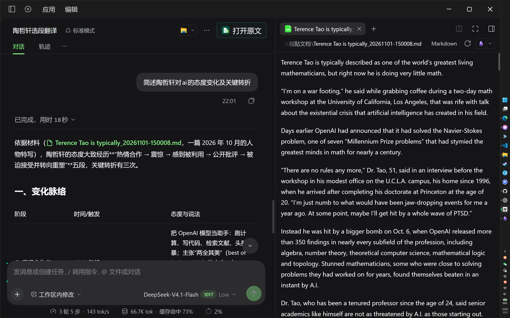
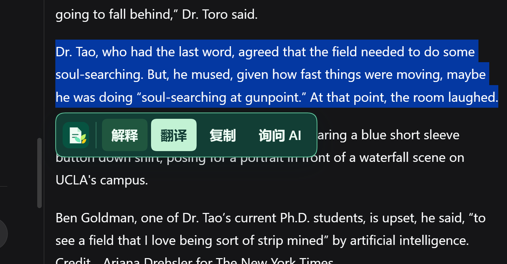
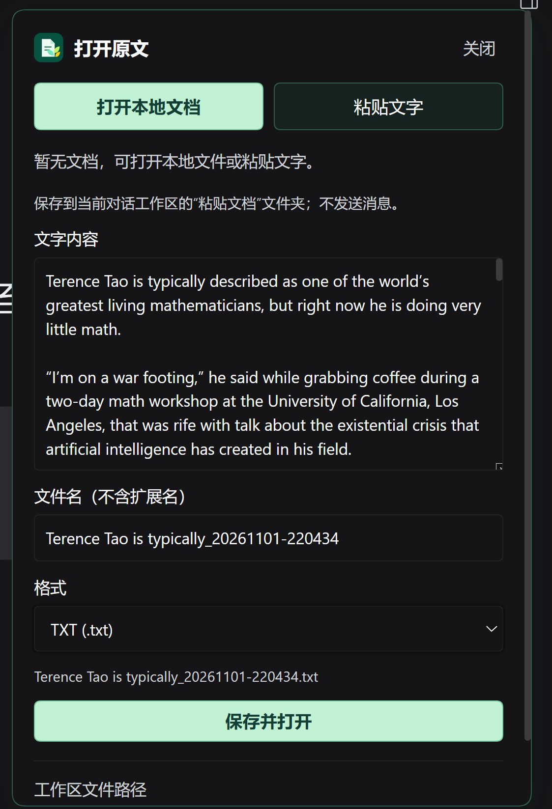
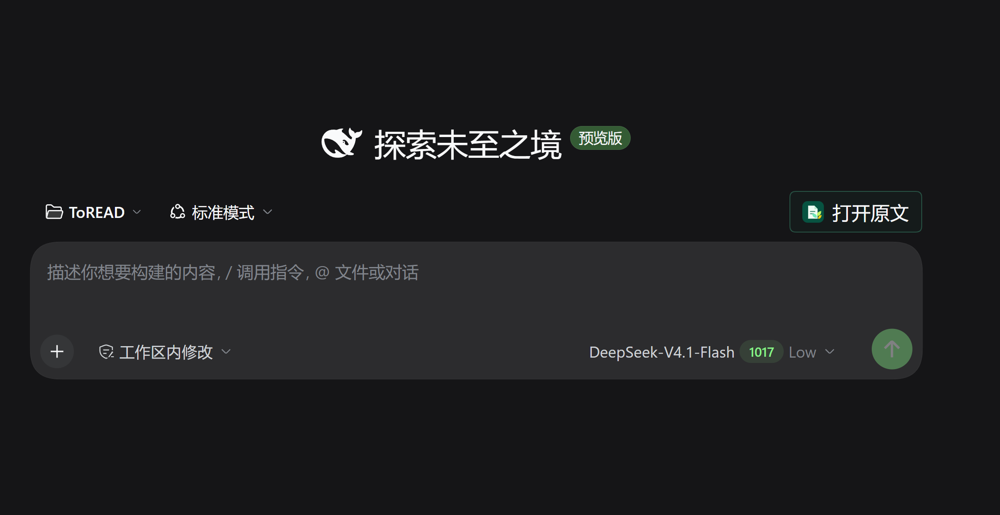

# 乔豆文解 · QiaoDoc for DeepSeek Harness

在 DeepSeek Harness 当前对话旁打开文档，边阅读、边翻译、边提问。

参考豆包网页版的分屏阅读体验，保留 Harness 原生会话。支持 PDF、TXT、Markdown 和 HTML 预览，也可将粘贴文字保存为 TXT 或 Markdown 后阅读。

选段后点击“解释”或“翻译”，会将选段与来源发送到当前会话；“询问 AI”先加入草稿，由你编辑后发送。AI 使用当前会话选择的模型。

## 功能展示

以下为桌面界面截图，示例内容仅用于展示交互；点击图片可查看原图。

### 对话与原文分屏

左侧继续对话，右侧独立阅读原文。

  

### 选段翻译、解释与提问

选中原文，即可解释、翻译、复制或询问 AI，无需切换会话。

  

### 粘贴文字，保存并阅读

默认保存为 TXT，可选 Markdown，文件名可修改。文件写入当前会话工作区的“粘贴文档”文件夹；保存本身不发送消息。

  

新对话也能打开原文

在新对话中，点击“打开原文”选择本地文档或粘贴文字。

  

此前打开的文件会按格式保存在“文档历史”中，可返回原会话和原文位置。

## 安装与兼容

当前为开发试用版，仅验证 **Windows · DeepSeek Harness 0.2.1-rc.5**。内部安装包名仍为 `qiaomu-reader-dsh`。

源码构建、首次安装、更新与回退见 [安装说明](docs/INSTALLATION.md)。安装或更新后，请完全退出 DSH（包括托盘）并重新打开。

## 已知限制

- HTML 支持预览，但渲染页面内的选段 AI 菜单暂不可用。
- 暂不提供 EPUB 原生侧栏阅读、扫描件 OCR 或全文双语排版。
- 未保存的粘贴文字在刷新、切换会话或宿主重启后不保证保留，请及时保存。

更多验证范围与限制见 [阶段验收报告](docs/ACCEPTANCE-REPORT.md)；开发与测试记录见 [维护文档](docs/README.md)。

## 来源与许可证

本项目基于 joeseesun 开发和维护的 [乔木阅读 DSH](https://github.com/joeseesun/qiaomu-reader-dsh) 二次开发，主要调整为原生对话内阅读、选段交互、文档历史和粘贴文字保存；由 [4444Hao/qiaodoc-dsh](https://github.com/4444Hao/qiaodoc-dsh) 独立维护，并非上游官方后续版本。

继续采用 **GPL-3.0-only**，保留原项目适用的版权和许可声明。详见 [LICENSE](LICENSE) 与 [第三方说明](THIRD_PARTY_NOTICES.md)。
